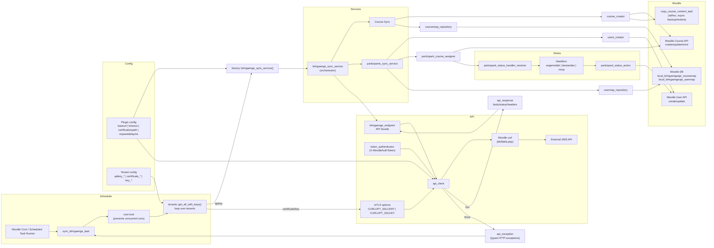

# local_lehrgaengeapi — Lehrgaenge API

A Moodle **local plugin** by [Wunderbyte GmbH](https://www.wunderbyte.at) that keeps Moodle in sync with an external
**ZMS / Lehrgangsverwaltung REST API**.

For every *Lehrgang* delivered by the external system the plugin creates a Moodle course from a template, creates a
Moodle user for every *Teilnehmer*, and enrols, unenrols or marks them complete according to their status. It is
multi-tenant: each Hessian district, city and school has its own API key and its own IOMAD company.

📖 **[Full documentation →](docs/README.md)**

---

## At a glance

| | |
|---|---|
| **Component** | `local_lehrgaengeapi` |
| **Release** | 0.2.5 |
| **Supported** | Moodle 4.5 and 5.0 |
| **Requires** | PHP 8.1+, [IOMAD](https://www.iomad.org/) (hard runtime dependency), outbound HTTPS to the ZMS API |
| **Licence** | GNU GPL v3 or later |

---

## What it does

- **Creates courses** for Lehrgänge, copied from a template course, named `<company code>-<course type>-<yy>`.
- **Funnels past years** into a single `<code>-<type>-<current yy>_alt` course, so historical imports produce
  completion records rather than a course per year.
- **Creates and matches users** by mapping table, `idnumber` and `username`, with business email preferred.
- **Enrols, unenrols and completes** participants based on their status in the external system.
- **Groups participants** per course run, named from the Lehrgang start date.
- **Logs every run** — scheduled or manual — with per-tenant and per-course counters in an admin UI.

It deliberately **never updates an existing course**: it creates what is missing and keeps enrolments in step.

---

## Quick start

1. Install IOMAD and create one company per tenant (`name` + `code` must match exactly).
2. Install the plugin into `local/lehrgaengeapi` and run the Moodle upgrade.
3. Set the API base URL and client certificate under
   *Site administration → Plugins → Local plugins → Lehrgaenge API*.
4. Enter the API key for each tenant you are entitled to read.
5. Create the template courses the plugin copies from.
6. Trigger a manual import for the current year and check the import history.

Each step is covered in detail in the [documentation](docs/README.md) — start with
[Installation](docs/user/installation/README.md).

---

## Documentation

| Guide | Contents |
|-------|----------|
| [Installation](docs/user/installation/README.md) | Requirements, the IOMAD dependency, install and upgrade |
| [Configuration](docs/user/configuration/README.md) | Every setting, including the ones that do nothing |
| [Tenants](docs/user/tenants/README.md) | The 35 tenants, API keys and company mapping |
| [Course creation](docs/user/course_creation/README.md) | Shortname convention, templates, `_alt` courses, HLFS routing |
| [Participants](docs/user/participants/README.md) | User creation, status mapping, enrolment, groups, completion |
| [Manual import](docs/user/manual_import/README.md) | The year import and the import history |
| [Scheduled tasks](docs/user/scheduled_tasks/README.md) | Schedules, locking and error handling |
| [Troubleshooting](docs/user/troubleshooting/README.md) | Symptom → cause → fix, and known quirks |
| [Architecture](docs/developer-guides/ARCHITECTURE.md) | Layers, data flow, class map, extension points |
| [API client](docs/developer-guides/API_CLIENT_API.md) | Client, endpoints, authentication, exceptions |
| [Sync services](docs/developer-guides/SYNC_SERVICE_API.md) | The orchestrators and the report format |
| [Status handlers](docs/developer-guides/STATUS_HANDLERS_API.md) | Status → action mapping and how to extend it |
| [Database schema](docs/developer-guides/DATABASE_SCHEMA.md) | The three plugin tables, column by column |
| [Testing](docs/developer-guides/TESTING.md) | PHPUnit suite, fakes, fixtures and CI |

---

## Architecture overview



---

## Development

```bash
# Coding standard
phpcs --standard=Moodle local/lehrgaengeapi

# Tests
php admin/tool/phpunit/cli/init.php
vendor/bin/phpunit local/lehrgaengeapi/tests
```

CI runs Moodle Plugin CI via Wunderbyte's shared workflow on every push and pull request, with
`codechecker_max_warnings: 0` and PHPMD enabled. See [Testing](docs/developer-guides/TESTING.md).

---

## Licence

GNU GPL v3 or later — see [https://www.gnu.org/copyleft/gpl.html](https://www.gnu.org/copyleft/gpl.html).

© Wunderbyte GmbH, [info@wunderbyte.at](mailto:info@wunderbyte.at)
